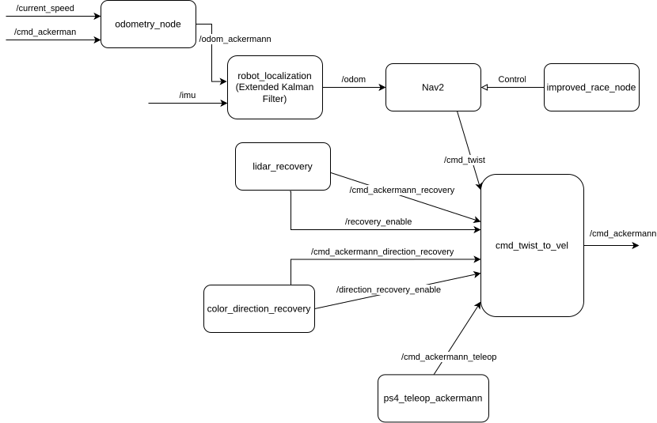

# ROSCon FR 2026

## Architecture ROS2




# Note de Sharaine

### First step dans le docker 

Debloquer les permissions pour la manette ps4 et enlever l'ancien rosconfr 
```bash
sudo chmod a+rw /dev/input/event* /dev/input/js*
sudo rm -rf /opt/rosconfr/
```

Installer slam toolbox et nav2 (vector pursuit est optionnel)
```bash
sudo apt update
sudo apt install ros-jazzy-slam-toolbox
sudo apt install ros-jazzy-navigation2 ros-jazzy-nav2-bringup
sudo apt-get install ros-jazzy-vector-pursuit-controller
```

### Changer les perfs

Dans le fichier worlds/Piste_CoVAPSy_2025a.wbt il faut changer 

```
WorldInfo {
  basicTimeStep 8 # Reduced from 32 ms to improve vehicle dynamics at higher speeds
  FPS 30 # Rendering at ~30 FPS may be needed on slower machines
}
```

### Activer et désactiver les voitures

Dans le fichier worlds/Piste_CoVAPSy_2025a.wbt (à la toute fin) il faut décommenté les voitures 

Et en plus pour la voiture jaune et bleu il faut décommenté `webots_bridge` et `state_publisher` dans webots_rosconfr.launch.py

### Comment lancer les controller ros2 de la voiture bleu

Lancer la simulation
```bash
ros2 launch webots_rosconfr webots_rosconfr.launch.py
```

Téléoperation
```bash
ros2 launch car_rosconfr teleop_ps4.launch.py

ros2 run car_rosconfr
```

Algorithme réactif:
```bash
ros2 run car_rosconfr follow_gap_blue
ros2 run car_rosconfr dial_nav_blue
ros2 run car_rosconfr simple_reactive_with_recovery_node
```

### Cartographie

```bash
ros2 launch webots_rosconfr webots_rosconfr.launch.py

ros2 launch car_rosconfr teleop_ps4.launch.py
ros2 run car_rosconfr teleop_ackermann

ros2 launch slam_toolbox online_async_launch.py  slam_params_file:=/home/turtle/ros2_ws/src/race_path_follower/params/slam_toolbox_params.yaml
```

### Nav2

```bash
ros2 launch webots_rosconfr webots_rosconfr_cam.launch.py

ros2 launch race_path_follower bringup_launch.py map:=/home/turtle/ros2_ws/src/race_path_follower/maps/Piste_2025a.yaml

ros2 run race_path_follower improved_race_node

ros2 run race_path_follower color_direction_recovery

ros2 launch webots_rosconfr rviz.launch.py
```


